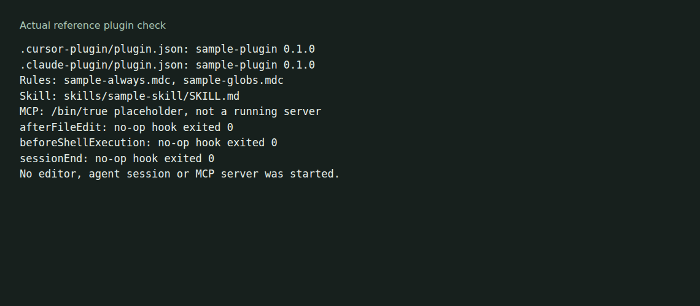

# agent-configs

Reusable skills, commands and plugin directories for AI coding agents. Choose a bundle or copy an individual skill with its reference files.



The [local check](docs/demo/README.md) parses both reference manifests, checks the sample skill and runs the shipped no-op hooks. It does not demonstrate editor installation or a live MCP connection.

## Start with the reference plugin

With Git and Node.js installed:

```sh
git clone https://github.com/olegpustovit/agent-configs.git
cd agent-configs
node docs/demo/check.cjs
```

This checks [plugins/sample-plugin](plugins/sample-plugin/). Its MCP command is `/bin/true`, a placeholder rather than a server. Its hooks exit successfully without changing files. Read the plugin's [installation notes](plugins/sample-plugin/README.md) before connecting it to an editor.

## Choose material

| Path | Contents |
| --- | --- |
| [plugins/go-skills-plugin](plugins/go-skills-plugin/) | Go development skills |
| [plugins/rust-dev](plugins/rust-dev/) | Rust development skills |
| [plugins/simplifier](plugins/simplifier/) | A smaller agent plugin |
| [skills](skills/) | Standalone skills with `SKILL.md` entry points |
| [skills/nudge-cli](skills/nudge-cli/) | Nudge CLI workflows and command references |
| [skills/paper-from-pack](skills/paper-from-pack/) | Drafting instructions and checks for a supplied writer pack. Human review remains necessary before submission. |
| [commands](commands/) | Shared command definitions |
| [workspaces](workspaces/) | Skill evaluation inputs and runs |

Keep a skill's whole directory when copying it, including scripts and references. Review instructions and tool requirements before enabling it. A directory's presence does not establish compatibility with every editor or agent version.

Plugin directories include `agentpack.toml` metadata. Use the dependency syntax supported by your installed [agentpack](https://github.com/olegpustovit/agentpack) version. Editor discovery and agentpack staging are separate integration checks; neither was run for the local reference check above.

## Add or change a skill

Put Go-specific skills under `plugins/go-skills-plugin/skills/`, Rust-specific skills under `plugins/rust-dev/skills/`, and shared skills under `skills/`. Each skill has its own directory with a `SKILL.md` entry point. See [AGENTS.md](AGENTS.md) for conventions and package boundaries.

[License](LICENSE)
